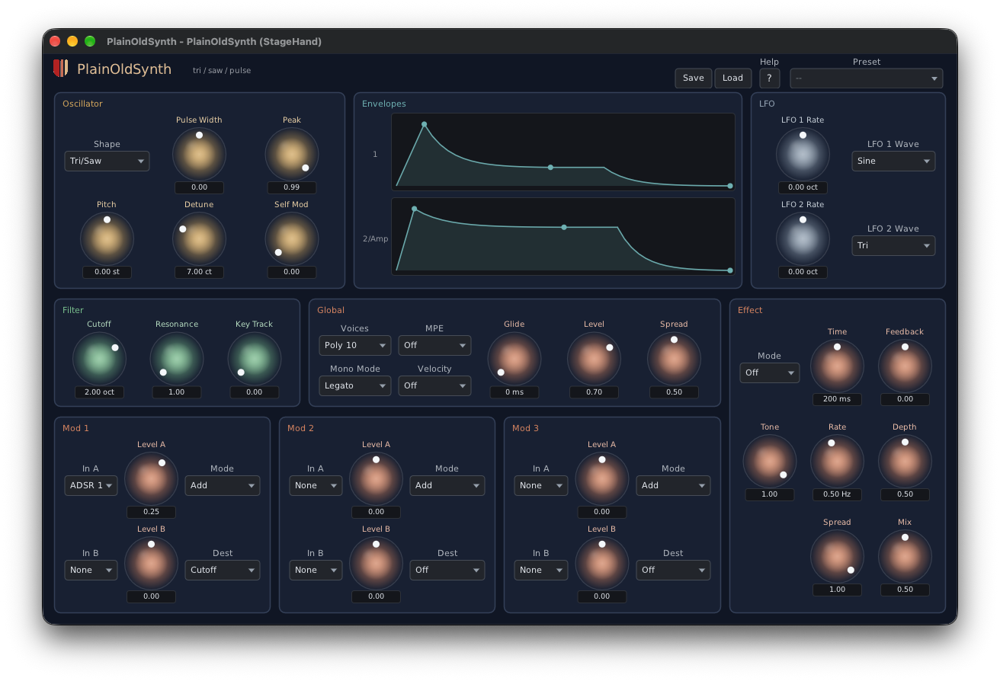

# PlainOldSynth

A classic subtractive synth from Unlikelyware: one stereo-detuned Tri/Saw/Pulse oscillator into a
24 dB/oct low-pass and a VCA, with two ADSRs, two LFOs, glide, poly or mono, and a flanger, chorus or
delay. The plain old synth, with MIDI 2.0 underneath.



| | |
|---|---|
| Formats | CLAP. VST® 3 and AUv2 (macOS) build from source; ready-built in a later preview |
| Platforms | Linux x86-64, macOS 26 or later on Apple Silicon. No Windows |
| Version | 0.9.0 (preview) |
| License | MIT |

**Downloads:** ready-built plugins will be on itch.io with the 0.9 preview. This repo has the
source only.

## What makes it different

- **MIDI 2.0 first.** The plugin takes MIDI 2.0 notes directly, so a Pitch 7.9 note plays its exact
  microtonal pitch, not the nearest semitone: an EDO keyboard such as
  [KeyboardEDO](https://github.com/erickampman/KeyboardEDO) is heard as played. Per-note pitch bend,
  Pitch 7.25 and per-note controllers reach only the note they name. MIDI 1.0 works too.
- **MPE and CLAP note expressions.** An MPE switch for MPE controllers, and in hosts that send CLAP
  notes (Bitwig) tuning, pressure and brightness arrive per note.
- **Plain on purpose.** One oscillator, one filter, two envelopes edited as draggable graphs, and
  three modulation sections whose sources include pressure and timbre. Detune is stereo width, not
  a beat.

The [help page](Resources/help.md), also behind the editor's Help button, describes every control.
[docs/how-it-works.md](docs/how-it-works.md) has the voice architecture and the MIDI 2.0 details.

## Known gaps

- Modulation can't yet drive an LFO's rate or another section's level.
- One effect slot: no reverb.
- MPE's upper zone isn't supported, and Pitch 7.25 lasts for the sounding note only (no tuning
  table).
- Factory presets are chosen in the editor; CLAP's preset discovery, which lets a host's browser
  list them, isn't implemented.

## Installing

The download holds `PlainOldSynth.clap`. Put it in your CLAP folder (create the folder if it isn't there),
then rescan plugins in your host:

| | Linux | macOS |
|---|---|---|
| For you | `~/.clap` | `~/Library/Audio/Plug-Ins/CLAP` |
| For every user | `/usr/lib/clap` | `/Library/Audio/Plug-Ins/CLAP` |

On macOS, `~/Library` is hidden in Finder: Go ▸ Go to Folder opens it.

A host that is already running keeps the plugins it loaded: quit and restart it. What each platform
needs, and more on rescanning, is in the downloads repo's [install
notes](https://github.com/erickampman/unlikelyware#installing). To build PlainOldSynth yourself
instead, see below.

## Building from source

```bash
git clone https://github.com/erickampman/PlainOldSynth.git
cd PlainOldSynth
tools/fetch_deps.sh
cmake -B build -G Ninja -DCMAKE_BUILD_TYPE=Release
cmake --build build
```

[BUILDING.md](BUILDING.md) has what to install first on Linux and macOS, the tests, installing
the plugin for hosts, and the build options.

## Help and bugs

Questions and bug reports go to [GitHub Issues](https://github.com/erickampman/PlainOldSynth/issues).

## License

MIT. See [LICENSE.txt](LICENSE.txt) and [THIRD_PARTY_NOTICES.md](THIRD_PARTY_NOTICES.md).

## Trademarks

VST is a registered trademark of Steinberg Media Technologies GmbH. Audio Units, Logic, Mac and
macOS are trademarks of Apple Inc., registered in the U.S. and other countries. Linux is the
registered trademark of Linus Torvalds in the U.S. and other countries. Other product names are
trademarks of their owners, named here only to say what works with what.
